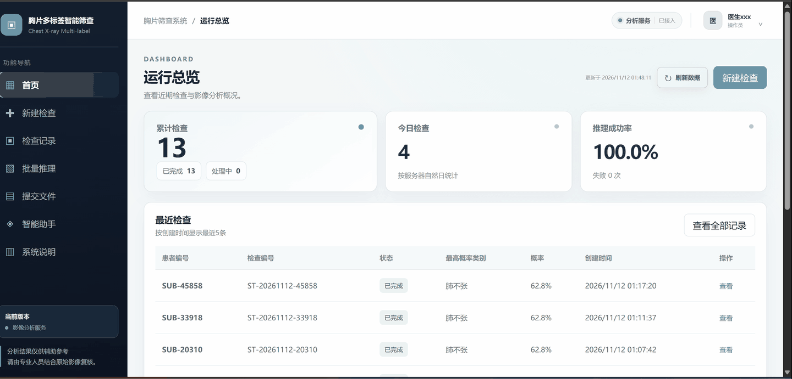
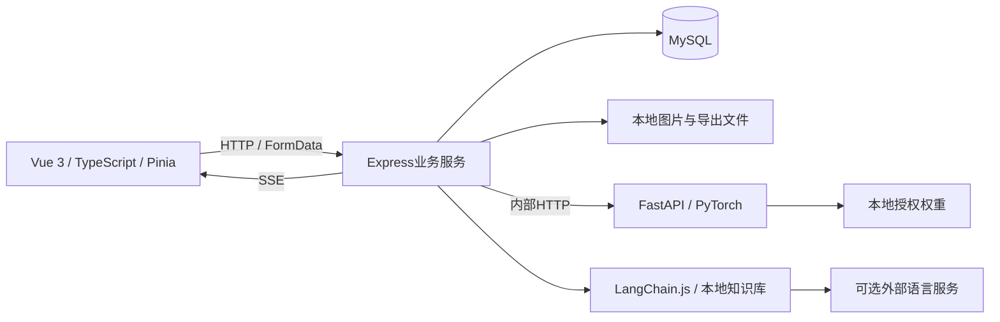
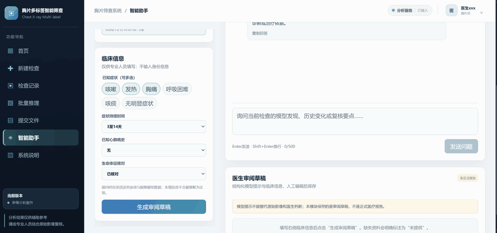
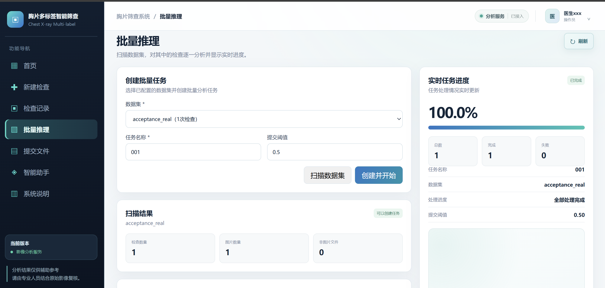
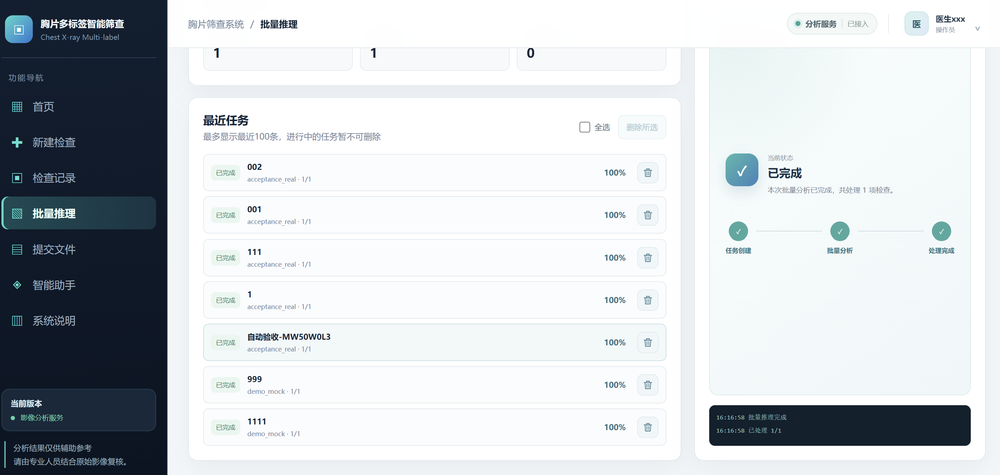
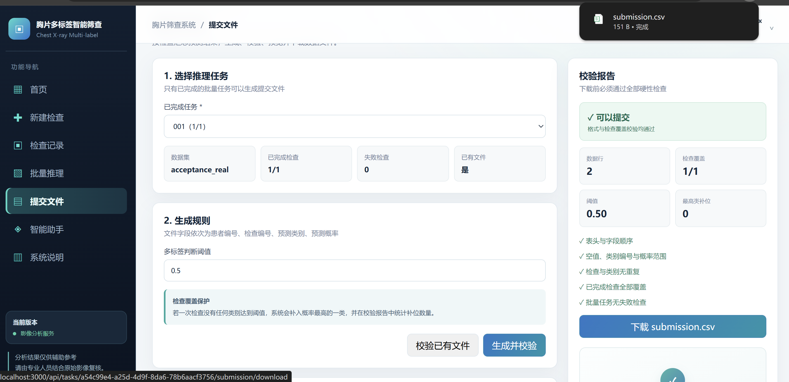

# 胸片多标签智能筛查系统

基于 Vue 3、TypeScript、Node.js / Express、Python / FastAPI 和 MySQL 的胸片辅助分析应用，集成 PyTorch 影像分析与 LangChain.js RAG 知识库助手。

上传胸片 → 14类评分 → Grad-CAM关注区域 → 检索增强对话 → 人工审阅，同时支持检查管理、批量任务和CSV导出。

> 用于学习、科研与工程实践，尚未经过临床部署验证。模型评分和关注区域仅供辅助复核，不能替代医生诊断。

[核心演示](#核心演示) · [系统架构](#架构) · [工程实现](#工程实现) · [技术栈](#技术栈) · [快速开始](#快速开始) · [功能展示](#功能展示)

## 核心演示

单张胸片从上传、分析到评分展示与解释图生成的实际操作，约17秒。



支持多图上传、逐图评分、缩放拖动和显示调整，解释图按当前图片与所选类别生成。

## 核心功能

| 模块 | 当前实现 |
| --- | --- |
| 账号与权限 | 登录、注册（可配置开放）、退出登录、Cookie会话与角色权限控制 |
| 运行总览 | 累计与今日检查、成功率、最近检查、类别计数和服务状态 |
| 新建检查 | 同次检查多图上传、格式校验、预览、亮度与对比度、缩放拖动 |
| 分析结果 | 14项原始评分、阈值突出显示、排序、真实Grad-CAM关注区域 |
| 检查记录 | 编号与状态筛选、分页、原图和详情、自定义删除确认 |
| 批量分析 | 本地数据集扫描、任务进度SSE、任务切换、单个及批量删除 |
| 结果导出 | CSV生成、字段及覆盖率校验、预览与下载 |
| RAG 知识库助手 | 检查关联、临床选项、本地知识库检索、分段回答、引用来源和审阅草稿 |

页面入口和演示操作见[功能演示指南](docs/FEATURE_WALKTHROUGH.md)。

## 架构



[架构与数据流](docs/ARCHITECTURE.md)说明上传、推理、关注区域和助手各自的职责。

## 工程实现

| 关注点 | 实现方式 |
| --- | --- |
| 状态管理 | Pinia管理认证及当前检查状态，页面交互使用Vue组合式API |
| 服务解耦 | Express处理业务与数据库，FastAPI执行图像分析；接口校验类别顺序与结果范围 |
| 输入与异常处理 | 格式规则与图像语义校验共同检查输入；校验未就绪或不确定时阻止分析 |
| 异步反馈 | SSE更新批量进度、分段传输聊天回答，前端缓冲显示文字 |
| RAG检索 | LangChain.js切分文档、编排BM25与TF-IDF检索链，为回答提供资料与引用来源 |
| 解释图性能 | 按需计算梯度、压缩输出、复用缓存；丢弃过期请求结果，避免切图串图 |
| 安装与交付 | 依赖锁文件、环境检查、引导脚本及发布白名单 |

构建和自动化检查命令见[验证](#验证)。

## 技术栈

| 层次 | 技术 | 在项目中的用途 |
| --- | --- | --- |
| 前端应用 | Vue 3、TypeScript、Vue Router、Pinia | 页面与组件、路由、认证及当前检查状态管理 |
| 前端构建与样式 | Vite、vue-tsc、CSS | 开发与构建、类型检查、自定义界面和交互样式 |
| 业务服务 | Node.js、Express、TypeScript | 认证、检查管理、批量任务、导出与助手API |
| 数据与上传 | MySQL、mysql2、Multer | 业务数据存储、数据库连接池、多图表单上传 |
| 图像分析服务 | Python、FastAPI、Uvicorn、PyTorch、TorchVision | 独立推理接口、EfficientNet-B0加载、14类评分与Grad-CAM关注区域 |
| 输入准入与预处理 | Transformers、CLIP、Pillow、NumPy | 本地图像语义校验、格式与图像特征规则、尺寸与像素处理 |
| RAG 知识库助手 | LangChain.js（TypeScript）、本地Markdown知识库、BM25与TF-IDF | 文档切分、检索链编排、关键词与文本相似度融合检索，为回答提供资料上下文与引用来源 |
| 语言服务接入 | Fetch、Chat Completions兼容HTTP接口 | 调用可配置的外部语言服务，失败时使用本地规则回答 |
| 通信与交互反馈 | HTTP、FormData、SSE、浏览器ReadableStream | 文件提交、批量进度事件、聊天分段接收与缓冲显示 |
| 认证与权限 | Cookie会话、HttpOnly、SameSite、scrypt、角色权限校验 | 登录状态、密码哈希与接口访问控制 |
| 测试与交付 | Python unittest、npm锁文件、PowerShell、GitHub Actions、SHA-256清单 | 自动化测试、安装构建、持续集成配置与发布文件核对 |

RAG与聊天传输方式见[智能助手的实际实现](#智能助手的实际实现)。

## 快速开始

前置环境：**Windows x64、Node.js 22.12及以上、Python 3.12、已启动的MySQL 8**。首次安装需联网访问npm、Python依赖源、GitHub和Hugging Face，并下载推理依赖及约600MB图像准入权重。

下载或克隆源码后，在项目根目录打开PowerShell，执行：

```powershell
npm run quickstart
```

引导命令完成安装构建、本地配置、数据库初始化、两类模型下载和启动。按提示填写自己的MySQL账号及初始管理员账号；MySQL需有建库建表权限，已有表和记录不会被清空。

打开 http://127.0.0.1:3000 ，使用配置的管理员登录。样例位于[examples/chest-xrays](examples/chest-xrays/README.md)。停止用 `npm stop`，再次启动用 `npm start`；更新代码或依赖后先运行 `npm run setup`。

在线智能助手密钥可选：在 `server/.env` 设置自己的 `LLM_API_KEY`、`LLM_BASE_URL` 和 `LLM_MODEL`；未配置时使用本地规则回答。

<details>
<summary>单独安装、配置与检查命令</summary>

| 操作 | 命令 |
| --- | --- |
| 安装依赖、构建并准备模型 | `npm run setup` |
| 修改本地数据库和初始管理员配置 | `npm run configure -- -Force` |
| 初始化数据库结构 | `npm run db:init` |
| 下载或检查两类模型 | `npm run models:prepare` |
| 检查环境 / 启动 / 停止 | `npm run check` / `npm start` / `npm stop` |

已有账号不会因修改初始密码配置而重置密码。安装故障与数据库权限处理见[Windows安装指南](docs/INSTALL_WINDOWS.md)。

</details>

### 疾病模型下载

引导命令自动下载并校验SHA-256。手动获取：打开 **[模型 Release](https://github.com/tao706/chest-xray-screening/releases/tag/model-v1.0.0)**，从 **Assets** 下载 `chest_model.pt`，放入 `inference/weights/`。校验与图像准入权重配置见[权重说明](docs/MODEL_DOWNLOAD.md)。

## 体验样例

随附三张CC0胸片，作者、来源和校验值见[样例说明](examples/chest-xrays/README.md)。可用于体验上传与分析，不作为准确率测试集。

## 功能展示

### RAG 知识库助手

临床信息 → 审阅草稿 → 快捷提问 → 分段回答与继续追问，约17秒。引用来源展开未包含在本段录制中。



<details>
<summary>更多功能截图：批量分析、任务管理、结果导出与其他界面</summary>

**批量分析**：扫描数据集、创建任务，查看处理进度及完成、失败数量。



**任务管理**：最近任务列表提供单条删除和全选删除入口；进行中的任务不可删除。



**结果导出**：生成CSV并检查字段、评分范围、重复项与检查覆盖情况，校验通过后下载文件。



**运行总览**：检查统计、最近记录与服务状态。


**分析结果**：14类评分、显示阈值和类别排序。


**影像操作**：切图、缩放、显示调整与解释类别选择。


**审阅草稿**：整理模型提示、重点复核、信息缺口及下一步核对内容。


**检查关联与对话**：查询患者检查并结合临床选项辅助提问。


</details>

演示中的计数、评分和耗时为录制或截图时的状态，不代表模型准确率、性能基准或临床评估结果。

## 智能助手的实际实现

- **RAG**：按问题类型检索本地Markdown知识库，结合资料与检查记录生成回答并返回引用。LangChain.js负责文档切分与链编排，项目内实现BM25与TF-IDF融合检索，未使用Embedding或向量数据库。
- **语言服务**：可接入Chat Completions兼容API；未配置或调用失败时使用本地规则回答。临床上下文发送受`CLINICAL_LLM_ENABLED`控制。
- **分段显示**：后端先生成并校验完整回答，再经SSE分段发送，前端缓冲显示；当前不是上游token实时透传。

配置见[助手说明](docs/LLM_SETUP.md)。

## 模型和结果含义

模型由协作者训练提供，本项目负责服务接入与应用功能。当前使用xray-project交付的EfficientNet-B0权重，输入224像素；类别、版本和数据来源说明见[模型卡](docs/MODEL_CARD.md)。

- 输出为14种异常影像表现的独立评分，不含“正常／无异常发现”。没有项目达到显示阈值不代表正常。
- Grad-CAM表示网络关注区域，不输出病灶检测框，也不能确认病灶位置、范围或严重程度。
- 导出时若没有评分达到阈值，现有规则会补入最高分项并记录补位数量；这是导出覆盖规则，不是阳性判断。

协作者离线报告记录 **macro AUC约0.651、macro F1约0.176**，本项目尚未独立复现，不代表临床表现。来源见[评估范围](docs/MODEL_CARD.md#已知评估范围)。

## 验证

<details>
<summary>展开构建与测试命令</summary>

安装依赖后运行：

```powershell
npm run build
& .\inference\.venv312\Scripts\python.exe .\scripts\ci-image-input.py
& .\inference\.venv312\Scripts\python.exe .\scripts\ci-model-contract.py
npm run test:bootstrap
& .\inference\.venv312\Scripts\python.exe .\scripts\ci-download-model.py
npm run check:release
```

上述两组Python测试不需要疾病模型权重。进行真实模型与接口验收时另运行：

```powershell
npm run check:model
npm run test:acceptance
```

模型自检默认使用随附公开胸片；接口验收需已运行的服务、数据库、配置账号与本地验收数据，并会创建专用测试记录。

</details>

## 目录

```text
frontend/   Vue页面、组件、状态与API调用
server/     认证、业务接口、数据库访问、批量处理与RAG
inference/  FastAPI入口、权重适配、Grad-CAM及训练代码
database/   MySQL结构初始化
scripts/    安装、检查、构建、启动、验收和发布检查
docs/       架构、接口、安装、模型与许可说明
datasets/   本地数据集入口，不进入公开仓库
```

## 持续集成

GitHub Actions覆盖Windows上的Node.js 22/24构建、Python 3.12依赖与模型契约、发布路径检查。运行状态见仓库Actions页面，工作流说明见[CI说明](docs/CI.md)。

## 当前限制

- 主要验证环境为Windows CPU；Linux/Docker仍在准备与验证，macOS、CUDA与公网运行未验收。
- 批量任务与SSE状态依赖当前服务进程，崩溃恢复待验证；当前采用共享工作区，不提供多租户隔离。
- [输入校验](docs/INPUT_VALIDATION.md)不能可靠识别所有非胸片；尚未完成并发压测、安全审计、隐私合规认证或临床验证。
- 外部语言API需要网络与凭据，可能产生费用。

## 许可

自有代码及协作者训练、适配代码采用[MIT](LICENSE)。权重、图片和第三方依赖适用各自条款，见[许可范围](docs/LICENSE_SCOPE.md)、[第三方声明](THIRD_PARTY_NOTICES.md)与[授权状态](docs/LICENSING_STATUS.md)。

## 文档导航

[架构](docs/ARCHITECTURE.md) · [功能演示](docs/FEATURE_WALKTHROUGH.md) · [安装](docs/INSTALL_WINDOWS.md) · [接口](docs/API_CONTRACT.md) · [模型](docs/MODEL_CARD.md) · [文档索引](docs/README.md)
