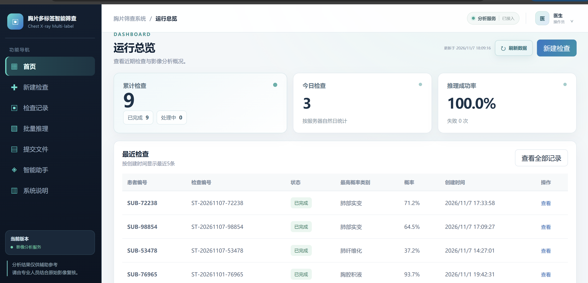
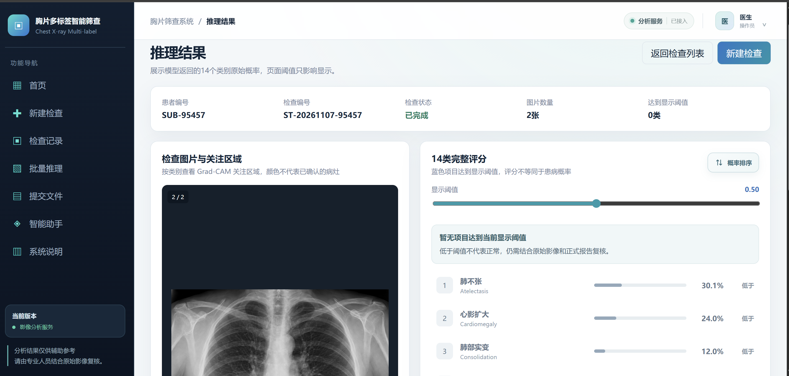
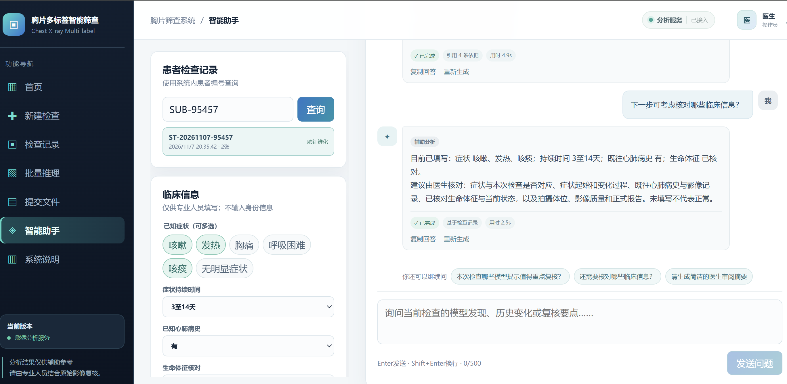
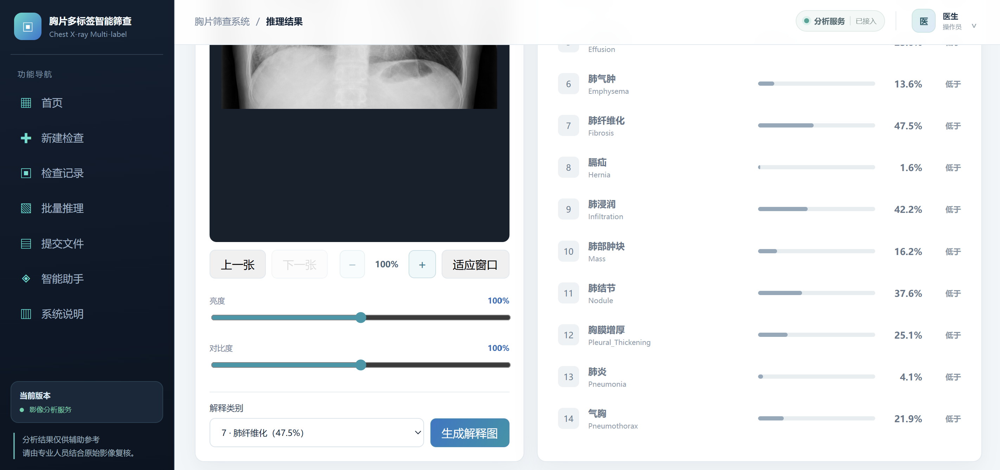
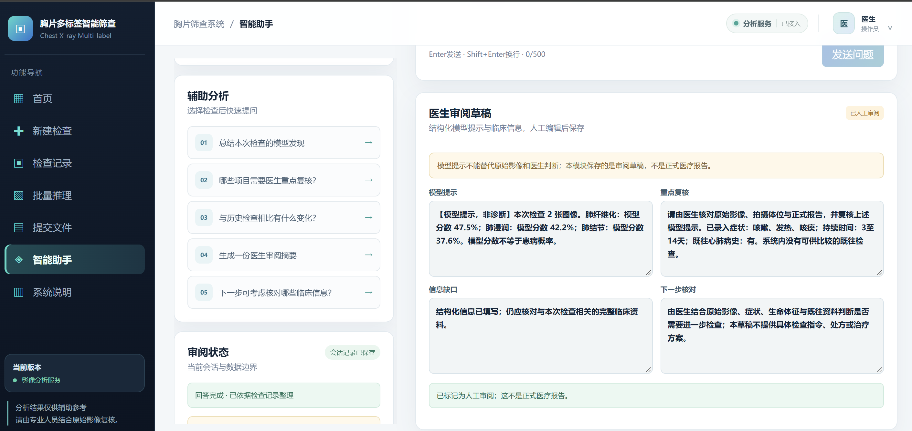
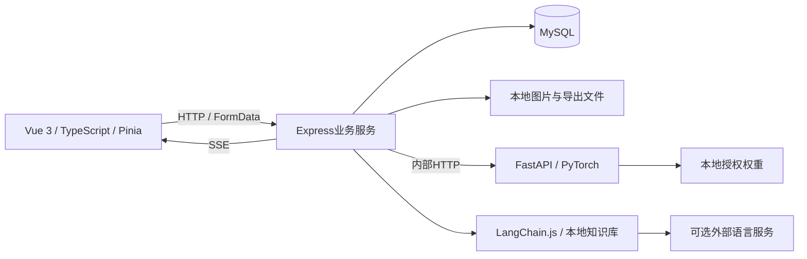

# 胸片多标签智能筛查系统

一个把胸片上传、14类影像评分、关注区域可视化和检索增强对话串联起来的 Web 应用。前端采用 Vue 3、TypeScript、Vue Router、Pinia 与 Vite；业务服务使用 Node.js、Express 与 MySQL；图像分析使用 Python、FastAPI、PyTorch 与 TorchVision；智能助手结合 LangChain.js、RAG 检索增强与 SSE 分段通信。

面向希望了解 AI 应用交互与前后端集成的开发者，支持从检查创建到结果复核、批量处理和审阅草稿的完整操作流程。项目用于学习、科研与工程实践，当前未经过临床部署验证。



**[在线演示](https://111.231.89.219)** · [功能展示](#功能展示) · [技术栈](#技术栈) · [工程实现与验证](#工程实现与验证) · [快速开始](#快速开始) · [模型说明](#模型和结果含义)

## 功能展示

### 胸片分析与可视化

同次检查支持多图上传，展示14项原始评分，可调整显示阈值、切换排序，并按类别生成 Grad-CAM 关注区域。原图支持缩放、拖动、亮度和对比度调整。



### 检索增强智能助手

关联检查记录和临床选项，结合本地知识检索回答问题；支持分段显示、引用来源、继续提问和医生审阅草稿。



<details>
<summary>展开查看影像操作与审阅草稿</summary>

影像操作：切换图片、缩放、适应窗口、亮度与对比度，以及按类别生成关注区域。



审阅草稿：整理模型提示、重点复核、信息缺口和下一步核对内容，支持人工编辑与保存。



</details>

以上为维护者提供的界面展示截图，页面中的计数、评分和耗时仅反映截图时的运行状态，不是性能基准、准确率或临床评估结果。

## 核心功能

| 模块 | 当前实现 |
| --- | --- |
| 运行总览 | 累计与今日检查、成功率、最近检查、类别计数和服务状态 |
| 新建检查 | 同次检查多图上传、格式校验、预览、亮度与对比度、缩放拖动 |
| 分析结果 | 14项原始评分、阈值突出显示、排序、真实Grad-CAM关注区域 |
| 检查记录 | 编号与状态筛选、分页、原图和详情、自定义删除确认 |
| 批量分析 | 本地数据集扫描、任务进度SSE、任务切换、单个及批量删除 |
| 结果导出 | CSV生成、字段及覆盖率校验、预览与下载 |
| 智能助手 | 检查关联、临床选项、知识检索、分段回答、来源展示和审阅草稿 |

页面入口和演示操作见[功能演示指南](docs/FEATURE_WALKTHROUGH.md)。

## 技术栈

| 层次 | 技术 | 在项目中的用途 |
| --- | --- | --- |
| 前端应用 | Vue 3、TypeScript、Vue Router、Pinia | 页面与组件、路由、认证及当前检查状态管理 |
| 前端构建与样式 | Vite、vue-tsc、CSS | 开发与构建、类型检查、自定义界面和交互样式 |
| 业务服务 | Node.js、Express、TypeScript | 认证、检查管理、批量任务、导出与助手API |
| 数据与上传 | MySQL、mysql2、Multer | 业务数据存储、数据库连接池、多图表单上传 |
| 图像分析服务 | Python、FastAPI、Uvicorn、PyTorch、TorchVision | 独立推理接口、EfficientNet-B0加载、14类评分与Grad-CAM关注区域 |
| 输入准入与预处理 | Transformers、CLIP、Pillow、NumPy | 本地图像语义校验、格式与图像特征规则、尺寸与像素处理 |
| 检索增强助手 | LangChain.js（TypeScript）、本地Markdown知识库、BM25与TF-IDF | 文档切分、检索链编排、关键词和文本相似度融合检索 |
| 语言服务接入 | Fetch、Chat Completions兼容HTTP接口 | 调用可配置的外部语言服务，失败时使用本地规则回答 |
| 通信与交互反馈 | HTTP、FormData、SSE、浏览器ReadableStream | 文件提交、批量进度事件、聊天分段接收与缓冲显示 |
| 认证与权限 | Cookie会话、HttpOnly、SameSite、scrypt、角色权限校验 | 登录状态、密码哈希与接口访问控制 |
| 测试与交付 | Python unittest、npm锁文件、PowerShell、GitHub Actions、SHA-256清单 | 自动化测试、安装构建、持续集成配置与发布文件核对 |

RAG在此指“检索资料后辅助生成回答”的流程：LangChain.js负责切分与链编排，检索逻辑在项目内实现。SSE聊天采用完整生成后分段传输，具体行为见[智能助手的实际实现](#智能助手的实际实现)。

## 工程实现与验证

| 关注点 | 实现方式 |
| --- | --- |
| 前端状态与交互 | Vue组合式API、TypeScript、Pinia；影像缩放拖动、阈值筛选和任务多选 |
| 业务与分析解耦 | Express处理认证、检查和数据库；FastAPI执行图像分析，接口校验类别顺序与结果范围 |
| 输入准入与异常处理 | 格式规则与本地图像语义校验共同拦截不合格输入；校验未就绪或不确定时不进入疾病分析 |
| 实时反馈 | 批量任务通过SSE更新进度；聊天通过SSE分段传输并由前端缓冲显示 |
| 检索增强回答 | LangChain.js编排文档切分和检索，采用本地BM25与TF-IDF，无需向量数据库 |
| 部署复现 | npm锁文件、Windows CPU Python版本锁、环境检查及白名单发布脚本 |

当前本机验证结果：

- **30项自动化测试通过**：8项输入准入、5项模型契约、4项下载完整性、5项本地配置、6项演示策略与2项并发保护测试。
- **独立目录安装与构建通过**：使用锁文件重新安装前后端依赖，完成Vue类型检查、Vite构建和Express TypeScript编译。
- **上传接口回归通过**：人物照、日常场景照及其灰度版本返回拒绝提示；公开胸片样例通过；拒绝输入未生成检查记录。这是有限样本回归，不是完整识别率评估。
- **发布检查通过**：检查实际跟踪路径及源码发布范围，排除真实配置、运行记录和模型权重。

验证步骤见[验证说明](#验证)。首次GitHub Actions云端检查已通过（2026-11-09核对），后续以仓库Actions页面的对应提交状态为准。

## 快速开始

前置环境：Windows x64、Node.js 22.12及以上、Python 3.12、已启动的MySQL 8。首次安装需要访问npm、Python依赖源、GitHub与Hugging Face，并下载推理依赖及约600MB图像准入权重，耗时取决于网络。

下载或克隆源码后，在项目根目录打开PowerShell，执行：

```powershell
npm run quickstart
```

命令依次完成依赖安装与构建、交互填写本地配置、初始化数据库结构、下载两类模型、环境检查与启动。配置时输入自己的MySQL账号密码，以及自定的初始管理员账号密码；密码输入隐藏，不会上传。MySQL账号需要创建数据库与表的权限，已有表和记录不会被清空。

启动后打开 http://127.0.0.1:3000 ，使用刚配置的管理员登录，选择随附公开胸片体验。停止服务用 `npm stop`。再次执行会复用现有配置和本地模型；代码或依赖更新后先执行 `npm run setup` 重新构建。

在线智能助手密钥可选：在 `server/.env` 设置自己的 `LLM_API_KEY`、`LLM_BASE_URL` 和 `LLM_MODEL`；未配置时使用本地规则回答。无需本地安装即可访问[在线演示](https://111.231.89.219)，演示范围见下文。

| 单独操作 | 命令 |
| --- | --- |
| 安装依赖、构建并准备模型 | `npm run setup` |
| 修改本地数据库和初始管理员配置 | `npm run configure -- -Force` |
| 初始化数据库结构 | `npm run db:init` |
| 下载或检查两类模型 | `npm run models:prepare` |
| 检查环境 / 启动 / 停止 | `npm run check` / `npm start` / `npm stop` |

疾病模型下载后核对SHA-256，失败不覆盖原文件，断网时会停止并提示重试。已存在账号不会因为修改初始密码配置而重置密码。手动安装、网络失败及数据库权限处理见[Windows安装指南](docs/INSTALL_WINDOWS.md)和[权重说明](docs/MODEL_DOWNLOAD.md)。

### 疾病模型下载

引导命令会自动下载。需要手动获取时，打开 **[模型 Release 下载页](https://github.com/tao706/chest-xray-screening/releases/tag/model-v1.0.0)**，在 **Assets** 中下载 `chest_model.pt`，放入 `inference/weights/`。同页提供 `SHA256SUMS.txt`；校验步骤见[权重说明](docs/MODEL_DOWNLOAD.md)。

## 体验样例

[examples/chest-xrays](examples/chest-xrays/README.md)随附两张CC0正位胸片，作者、来源和校验值均已记录。配置权重后可选择图片体验上传与分析；两张图片分别建立检查，不作为模型准确率测试集。

## 在线演示

**演示地址：[https://111.231.89.219](https://111.231.89.219)**。已部署到云服务器，使用Docker Compose、HTTPS入口、独立演示数据库和样例限定模式，已确认公网浏览器可打开登录页。

支持自主注册，注册后自动登录；新账号默认为操作员。用户名使用3至50位字母、数字、下划线或连字符，密码至少8位且包含字母与数字。自行部署时可通过 `deploy/.env` 中的 `AUTH_ALLOW_REGISTRATION` 开启或关闭注册。

演示模式保留真实分析，限制上传为[随附公开胸片样例](examples/chest-xrays/README.md)，并关闭删除、批量任务和草稿保存。完整功能可按上方快速开始在本地运行。部署步骤与验证边界见[在线演示部署说明](docs/ONLINE_DEMO.md)。

## 架构



[架构与数据流](docs/ARCHITECTURE.md)说明上传、推理、关注区域和助手各自的职责。

## 智能助手的实际实现

助手查询结构化检查记录，并从本地Markdown资料检索依据。可配置兼容Chat Completions协议的语言服务；未配置密钥或调用失败时使用本地规则回答。临床上下文是否发送给外部服务还受CLINICAL_LLM_ENABLED配置控制。

当前后端先生成并校验完整回答，再通过SSE发送分段文字；前端逐帧显示以平滑网络分块。它尚不是上游语言模型token实时透传。配置和限制见[助手说明](docs/LLM_SETUP.md)。

## 验证

可在安装依赖后运行：

```powershell
npm run build
& .\inference\.venv312\Scripts\python.exe .\scripts\ci-image-input.py
& .\inference\.venv312\Scripts\python.exe .\scripts\ci-model-contract.py
npm run test:bootstrap
& .\inference\.venv312\Scripts\python.exe .\scripts\ci-download-model.py
npm run check:release
```

上述两组Python测试不需要疾病模型权重。进行真实模型与接口验收时另运行：

```powershell
npm run check:model
npm run test:acceptance
```

模型自检默认使用随附公开胸片；接口验收需已运行的服务、数据库、配置账号与本地验收数据，并会创建专用测试记录。

- [隔离安装验证](docs/INSTALL_VERIFICATION.md)
- [接口验收报告](docs/ACCEPTANCE_REPORT.md)
- [发布准备状态](docs/OPEN_SOURCE_READINESS.md)

## 模型和结果含义

胸片分类模型由协作者训练并提供，本项目负责模型服务接入与应用功能实现。

当前接入协作者交付的xray-project权重，检查点标识为nih14-efficientnet-b0-v1，EfficientNet-B0架构，224像素输入。类别表和文件证据见[模型说明](docs/MODEL_CARD.md)。训练数据来源仍以训练方材料核实，不能仅凭版本名认定。

- 输出为14种异常影像表现的独立评分，不含“正常／无异常发现”。没有项目达到显示阈值不代表正常。
- Grad-CAM表示网络关注区域，不输出病灶检测框，也不能确认病灶位置、范围或严重程度。
- 历史检查保留旧版类别名称；不按新类别编号重新解释旧结果。
- 导出时若没有评分达到阈值，现有规则会补入最高分项并记录补位数量；这是导出覆盖规则，不是阳性判断。

协作者交付的离线评估报告记录 **macro AUC约0.651、macro F1约0.176**。这是协作者报告中的模型指标，尚未由本项目独立复现；不作为应用交互性能或临床有效性的证明。来源与评估范围见[模型说明](docs/MODEL_CARD.md#已知评估范围)。

## 当前限制

Linux/Docker部署处于准备与验证阶段；macOS、CUDA与公网运行尚未验收。批量任务和SSE状态主要依赖当前服务进程，进程崩溃后的任务恢复仍需专项验证。当前是共享工作区，并非按医院或患者隔离的多租户系统。选图和推理入口增加了服务端影像初检，可拦截明显文档等输入，但不能可靠识别所有非胸片，详见[输入校验](docs/INPUT_VALIDATION.md)。

外部语言服务需要网络和授权凭据，可能产生费用。数据脱敏和回答规则是工程措施，不等于完成隐私合规认证或医学正确性保证。

自动化测试和本机验证尚不覆盖并发压测、安全审计与临床验证。模型评估、输入准入和应用测试的范围分别说明，不能互相替代。

## 目录

```text
frontend/   Vue页面、组件、状态与API调用
server/     认证、业务接口、数据库访问、批量处理与RAG
inference/  FastAPI入口、权重适配、Grad-CAM及训练代码
database/   MySQL结构初始化
scripts/    安装、检查、构建、启动、验收和发布检查
docs/       架构、接口、安装、模型与许可说明
datasets/   本地数据集入口，不进入公开仓库
```

## 持续集成

GitHub Actions覆盖Windows上的Node.js 22/24构建、Python 3.12依赖与模型契约、发布路径检查。首次远程运行已通过，后续状态见仓库Actions页面，工作流说明见[CI说明](docs/CI.md)。

## 许可

根据项目维护者确认，自有代码及队友训练、适配代码采用[MIT](LICENSE)。权重、数据图片与第三方依赖分别适用其自身条款，详见[许可范围](docs/LICENSE_SCOPE.md)、[第三方声明](THIRD_PARTY_NOTICES.md)及[授权状态](docs/LICENSING_STATUS.md)。本地完整目录不能直接作为公开发行包。

## 文档导航

[架构](docs/ARCHITECTURE.md) · [功能演示](docs/FEATURE_WALKTHROUGH.md) · [安装](docs/INSTALL_WINDOWS.md) · [接口](docs/API_CONTRACT.md) · [模型](docs/MODEL_CARD.md) · [文档索引](docs/README.md)

准备公开时按[发布候选检查](docs/PUBLICATION_CHECKLIST.md)生成白名单源码集合。
